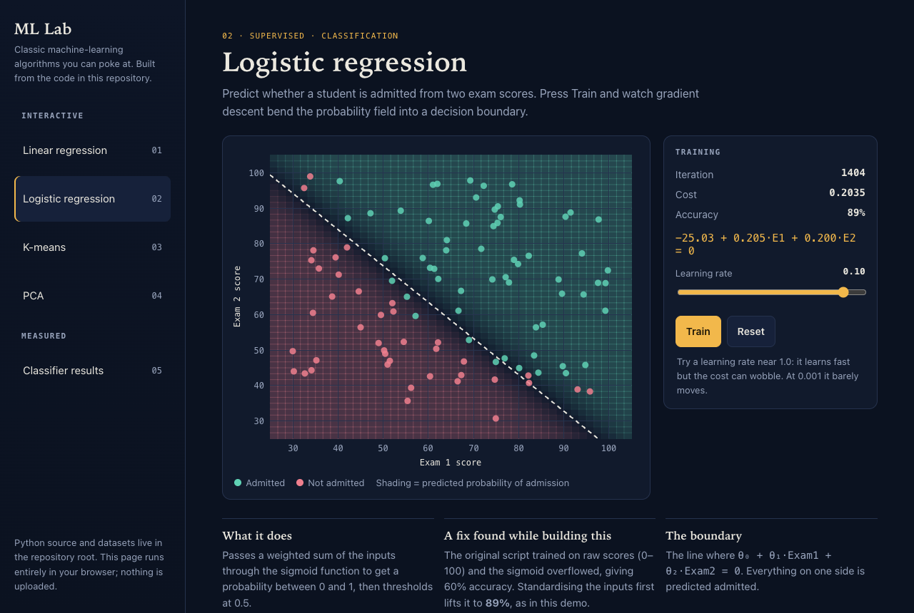

# ML Lab

Eight classic machine-learning algorithms and a descriptive-statistics script, written as small, readable Python scripts, plus an interactive browser lab that lets you run four of them yourself.

Each script is one algorithm on one dataset, short enough to read top to bottom. Some are written from scratch with NumPy and pandas (linear regression, logistic regression, k-means, PCA). Others use scikit-learn (decision tree, random forest, SVM, Naive Bayes).



## Try it in the browser

Open `docs/index.html` in any browser. There is nothing to install and nothing is uploaded.

| Experiment | What you can do |
|---|---|
| Linear regression | Click to add points and watch the line, R² and error change. Toggle residuals. |
| Logistic regression | Train with gradient descent, change the learning rate, and watch the decision boundary form. |
| K-means | Step through each iteration, add your own points, change k, or restart from random centroids. |
| PCA | Project the iris dataset to 2D, hover for the original measurements, filter by species. |
| Classifier results | The accuracy of the four scikit-learn scripts, measured by running them. |

To host it, enable GitHub Pages for this repository and choose the `/docs` folder.

## Run the scripts

```bash
pip install -r requirements.txt
python LinearRegression.py
```

Every script finds its dataset relative to its own location, so you can run it from any directory.

## What is in here

| Script | Algorithm | Dataset | Result |
|---|---|---|---|
| `LinearRegression.py` | Least squares, closed form | `Food-Truck-LineReg.csv` (97 cities) | R² = 0.702, plus a plot |
| `LogisticRegression.py` | Gradient descent | `Student-University.csv` (100 students) | 89% training accuracy |
| `Kmeans.py` | K-means, k = 3 | 10 points inside the script | Converges in 3 iterations |
| `PCA.py` | Eigen-decomposition of the covariance matrix | `iris(For PCA Program).csv` (150 flowers) | 97.8% of variance in 2 components |
| `DecisionTree.py` | Decision tree | `zoo_data.csv` (100 animals) | 100% test accuracy |
| `RandomForest.py` | Decision tree vs random forest | `B3-pima.csv` (768 patients) | 73.6% vs 75.3% |
| `SVM.py` | Support vector machine, three kernels | `glass(For SVM Program).csv` (214 samples) | RBF 79.6%, polynomial 96.3%, sigmoid 25.9% |
| `NaiveBayes.py` | Multinomial Naive Bayes | `covid.csv` (25 patients) | 28.6% on 7 test rows |
| `mean.py` | Descriptive statistics | 11 values inside the script | Mean 118.44, std 28.08 |

Results for the scikit-learn scripts use `random_state=42`, so you will get the same numbers.

## The algorithms

### Linear regression
Fits `y = m·x + c` by minimising the squared vertical distance to every point. The script uses the closed form `m = (mean(xy) − mean(x)·mean(y)) / (mean(x²) − mean(x)²)`, then reports SSE, SST, SSR and R². On the food-truck data the line is `y = 1.193·x − 3.896` and explains 70% of the variance in profit.

### Logistic regression
Passes a weighted sum of the two exam scores through the sigmoid function to get an admission probability, and learns the weights by gradient descent on the cross-entropy cost. The decision boundary is the line where that probability equals 0.5.

### K-means
Alternates two steps: assign each point to its nearest centroid, then move each centroid to the mean of its points. It stops when the centroids stop moving. The script prints the centroids and the shift at every iteration, and the browser lab shows the same numbers.

### PCA
Computes the covariance matrix of the four iris measurements, takes its eigenvectors, and projects every flower onto the two with the largest eigenvalues. Species 1 separates cleanly from the other two.

### Decision tree, random forest, SVM, Naive Bayes
Standard scikit-learn models trained on a train/test split, scored with accuracy. The random forest beats a single tree on the Pima data, and an SVM with a polynomial kernel does best on the glass data. A sigmoid kernel does badly there, a useful reminder that the kernel choice matters.

## Honest notes on the results

- **The small datasets are noisy.** Zoo has about 100 rows and COVID has 25, so a test set is 30 and 7 rows. One extra mistake moves accuracy by several points. Before the fixed seed, the decision tree scored 83% on one run and 100% on another.
- **The Naive Bayes score is not a verdict on Naive Bayes.** 28.6% on 7 test rows says more about the size of the dataset than the algorithm.
- **`zoo_data.csv` has no header row**, so the first animal is read as the column names and is not used for training or testing. That leaves 100 usable rows.
- **`PCA.py` does not subtract the mean** before projecting. The scatter plot has the same shape but is shifted away from zero. The browser lab centres the data.

## Fixes made while preparing this version

- Dataset paths pointed at folders on the original author's laptop (`/Users/…/Desktop/Programming/`). Every script now loads its dataset from next to the script.
- `LinearRegression.py` crashed with `KeyError: 'X'` because the CSV has no header. It now names the columns.
- `LogisticRegression.py` trained on raw scores, so the sigmoid overflowed and accuracy was 60%. It now standardises the inputs, clips the cost to avoid `log(0)`, and converts the weights back to the original score units. Accuracy is 89%.
- Train/test splits now use `random_state=42` for repeatable results.

## Repository layout

```
.
├── *.py                 the nine scripts
├── *.csv                the datasets they read
├── requirements.txt
└── docs/
    ├── index.html       the interactive lab (single file, no dependencies)
    └── assets/          screenshots used in this README
```

## Requirements

Python 3.9 or newer, with `numpy`, `pandas`, `scikit-learn` and `matplotlib`.
